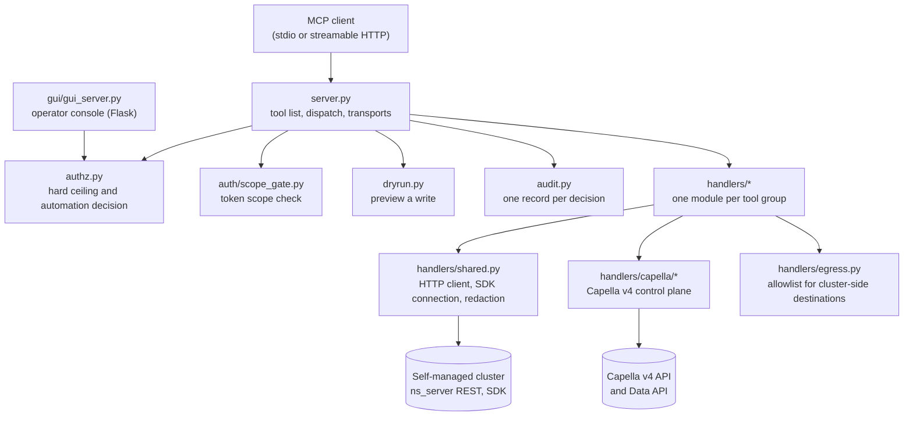

# Module map

Written 2026-11-02 from the code at the commit named in `CHANGELOG.md`. "Calls" lists
the repository modules a file imports, found with a Python `ast` scan of absolute
imports (see the command at the end). Relative imports inside `handlers/capella/` are
not in the scan, so read that package's header for its own layout.

## Request path, top to bottom



## Top level

| File | Purpose | Calls |
| --- | --- | --- |
| `server.py` | Builds the tool list, applies the gates in order, runs handlers on worker threads, serves stdio or HTTP, sets the protocol `isError` flag | `audit`, `auth.*`, `authz`, `deployment`, `dryrun`, `handlers.*`, `logging_config`, `mcp_compat`, `profile_config`, `tls_config` |
| `authz.py` | The confirmation and hard-ceiling decision, in one place, used by both the server and the console | `profile_config` |
| `audit.py` | Builds and emits the structured audit record, and classifies a handler's result | `handlers.shared`, `logging_config` |
| `deployment.py` | Detects which control plane this container drives and decides which tools can load | `logging_config` |
| `profile_config.py` | The two deployment profiles (workstation, enterprise), their defaults and the start-up coherence check | `handlers.shared`, `logging_config` |
| `dryrun.py` | Previews a write without performing it | `handlers.shared`, `mcp_compat` |
| `mcp_compat.py` | Reads tool metadata the same way on MCP library 1.x and 2.x | `dryrun` |
| `logging_config.py` | Log sinks, formats and redaction filter, configured from `CB_ADMIN_LOG_*` | `handlers.shared` |
| `tls_config.py` | TLS for the HTTP transport | none |
| `healthcheck.py` | Container health probe, shared by the image and both Kubernetes manifests | none |

## `auth/`

| File | Purpose | Calls |
| --- | --- | --- |
| `auth/oidc.py` | OIDC and OAuth 2.0 provider abstraction, token validation, JWKS handling and the refresh throttle | none |
| `auth/request_auth.py` | Resolves the calling principal inside the dispatch task | `auth`, `auth.oidc` |
| `auth/scope_gate.py` | Per-tool scope enforcement | `auth.request_auth`, `mcp_compat` |
| `auth/session.py` | Server-side sessions for the console login | `tls_config` |

## `handlers/`

Each tool group exports `TOOLS` (the tool definitions) and `handle(name, arguments)`.
`tests/test_handler_contract.py` checks every group against the same contract.

| File | Tool prefix and area |
| --- | --- |
| `buckets.py`, `collections.py` | `admin_bucket_*`, `admin_scope_*`, `admin_collection_*` |
| `security.py` | Users, groups, roles, audit settings, certificates, password policy |
| `cluster.py` | Nodes, rebalance, failover, server groups |
| `xdcr.py`, `indexes.py`, `search_admin.py`, `eventing.py` | XDCR, index management, full-text search index admin, Eventing functions |
| `stats.py`, `diagnostics.py`, `mcp_status.py` | Statistics and events, schema and advisor tools (`cb_*`), reports on this server process |
| `eight_x.py`, `encryption.py` | Couchbase 8.x features, data-at-rest encryption and KMIP |
| `backup.py`, `backup_catalog.py` | Backup service tools, and the user-defined backup catalogue that works on both control planes (`cb_backup_catalog_*`) |
| `fixture.py`, `fixture_core.py` | Fixtures on self-managed (`admin_fixture_*`) and the plane-neutral mechanics shared with Capella |
| `egress.py` | Allowlist for destinations the cluster is asked to contact |
| `shared.py` | HTTP admin client with retries, SDK connection, response helpers, redaction, the confirmation primitives |
| `capella/` | The Capella v4 control plane: `spec.py` (declarative registry of operations), `spec_pending.py` (written, not shipped), `client.py` (HTTP client), `guardrails.py` (blast-radius controls), `environment.py` (test environments), `fixture.py` (Capella fixtures through the Data API) |

## Other folders

| Folder | Purpose |
| --- | --- |
| `gui/` | The operator console. `gui_server.py` is the Flask backend, `static/` the front end |
| `deploy/` | Compose files, Kubernetes manifests, example environment files, the identity provider lab |
| `scripts/` | Maintainer tools: live verification, mutation rounds, probes, lab set-up |
| `tests/` | The regression suite, including the documentation gate |
| `docs/` | This handover set and the design documents |

## Import cycles that exist today

Found in the same scan, and not changed here:

- `logging_config` and `handlers.shared` import each other.
- `mcp_compat` and `dryrun` import each other.
- `handlers.mcp_status` imports `server`, and `server` imports `handlers.mcp_status`.

In each pair, one side imports inside a function (`logging_config.py` line 127,
`mcp_compat.py` line 130, `handlers/mcp_status.py` line 230), which is why start-up
works. A change that moves one of those imports to module level can break start-up. Whether to remove them is
[Q-002 in questions.md](questions.md).

## How to regenerate the "Calls" column

```bash
uv run python - <<'PY'
import ast, subprocess
files = [f for f in subprocess.run(["git", "ls-files", "*.py"], capture_output=True, text=True).stdout.split()
         if not f.startswith(("tests/", "scripts/", "docs/"))]
mods = {f[:-3].replace("/", ".").removesuffix(".__init__"): f for f in files}
for m, f in sorted(mods.items()):
    found = set()
    for n in ast.walk(ast.parse(open(f).read())):
        if isinstance(n, ast.Import):
            names = [a.name for a in n.names]
        elif isinstance(n, ast.ImportFrom) and n.module and n.level == 0:
            names = [n.module] + [f"{n.module}.{a.name}" for a in n.names]
        else:
            continue
        found |= {x for x in names if x in mods and x != m}
    print(m, "->", ", ".join(sorted(found)))
PY
```
